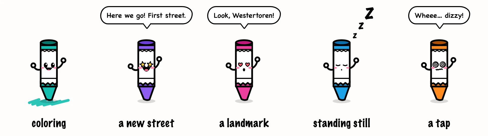

<p align="center">
  
</p>

<h1 align="center">Mr Sparkles</h1>

<p align="center">
  <b>Your city's coloring book. Every street you walk gets colored in with crayon, for good.</b><br>
  A walking motivator for your iPhone, with a demo walk in any browser.<br>
  No account, no server, no tracking: your walks stay on your phone.
</p>

<p align="center">
  <a href="https://annvaskovska.github.io/walking-game/"></a>
</p>

<p align="center">
  <a href="https://github.com/annvaskovska/walking-game/actions/workflows/ios.yml"></a>
  
  
  
</p>

<p align="center">
  
</p>

<p align="center">
  <sub>The app as it draws itself, at phone size.
  Left, the cover; middle, the first 90 seconds of the demo walk at 10× speed; right, the fridge after 1.3 km.
  Nothing in the screens is edited: every stroke of crayon comes from a step of the walk.</sub>
</p>

<p align="center">
  If Mr Sparkles gets you out for a walk, <a href="https://github.com/annvaskovska/walking-game">a star</a> helps other people find it.
</p>

---

# What is Mr Sparkles?

Mr Sparkles is a walking motivator for your iPhone.
Your city starts as a black ink drawing on white paper.
Every street you walk is colored in with crayon, with its houses and its name, and it stays colored in.
So each walk shows you where you have not been yet.

A step counter tells you that you walked.
Mr Sparkles shows you where: the walk you would forget by dinner becomes a page of your city, in color.

On the map you are Mr Sparkles, a stubby crayon who colors in the street under your feet.
He gets star eyes for a new street, heart eyes for a landmark, and wears down a little as you walk.

| Mr Sparkles takes the place of | With |
| --- | --- |
| A step counter | Time, distance, and steps in a crayon box, and one more crayon for every new street. |
| A route tracker's map | Your whole city as a coloring book that keeps every street you walked, block by block. |
| A city guide | A crayon that points out the cafés, shops, and landmarks you see, and colors in their pictures. |
| A walking buddy | Emoji eyes that react: stars, hearts, a Zzz when you stop, and spirals when you tap him. |
| A photo of your route | The page of each walk on the fridge: its map, its distance, and its new streets. |
| A fitness account | Nothing to sign up for: no account, no server, and your walks never leave the phone. |

---

# Core features

## Walk a street, and it gets colored in

Walk along a street and its crayon sweeps in behind you, from the end you came in.
Walk half a block, and the whole block colors in, junction to junction.
Each street keeps one crayon of 13, and the houses beside it are hatched in too: many in the street's crayon, the rest in crayons of their own.
A new street gets its name written big across the page in its crayon, and the crayon pops up in your crayon box.
A street you walk only part of still shows where you went.

<p align="center">
  
</p>

## Mr Sparkles reacts to your walk

Mr Sparkles colors in left and right as you walk, and his eyes follow each stroke.
A new street gives him star eyes, and a landmark heart eyes as he names it in his speech bubble.
Stand still and he looks around, blinks, and dozes off with a Zzz.
Tap him and his eyes spin; hold a finger near him and he looks at it.
Turn the phone to look around: the landmarks he spots follow the compass.

<p align="center">
  
</p>

## Only real walking counts

Nothing colors from a tap: as the cover says, *Tapping colors nothing. Walking does.*
GPS fixes that are too inaccurate, glitchy jumps, and rides on a bike, a tram, or in a car are ignored.
A step colors only the street it runs along, so walking past a side street does not color it.

## Walk with the screen locked

The iPhone app keeps recording with the screen locked.
Put the phone in your pocket, and when you look again, the streets you walked are colored in at once.

## Your walk goes on the fridge

The crayon box at the bottom shows the time, the distance, and an estimate of your steps, with one crayon for each new street.
Tap **End**, then **End walk?** to be sure, and the page of your walk goes on the fridge: its map, the distance, and the new streets.
Back on the cover, your score is waiting: the streets you colored in and the kilometers you walked.

<p align="center">
  
</p>

---

# All features

### Coloring in

- 13 crayons, one for each street, picked from its name
- A street colors in piece by piece: each 20 m piece once 40% of it is walked
- Half a block walked, at least 8 m, colors in the whole block, up to 160 m between junctions
- The crayon sweeps in from the end you came in
- Houses within 20 m of a colored street are hatched in, off register like a real crayon
- Your trail in the pressed crayon of the street you follow
- Street names written along their street, in their crayon
- A new street's name written big across the page, letter by letter
- Colored streets stay colored after the map data updates

### Mr Sparkles

- Colors in left and right, and leans into where he heads
- Big eyes that follow each stroke
- Star eyes and a wave for a new street
- Heart eyes for a landmark
- Blinks and looks around when you stop, then sleeps with a Zzz
- Spiral eyes when you tap him
- Looks at a finger near him
- Wears down over a walk, and is a new crayon on the next
- A speech bubble for new streets, bridges, cafés, bars, bakeries, art, bookshops, and sights
- With reduced motion on, he holds still and only his face changes

### The map

- A black ink drawing on white paper, at the scale of a coloring book
- Houses in outline, waves in the canals, cloud trees in the parks, and dashed paths
- Pictograms for cafés, restaurants, bars, bakeries, art, hairdressers, books, sights, churches, and shops
- The Westertoren drawn in full
- The pictograms of places you see get colored in
- The camera follows you, and comes back 9 s after you pan away
- Pinch from the whole city down to a single house

### Walking and GPS

- Fixes less accurate than 35 m are ignored
- Glitch jumps are dropped, and a run of them re-anchors without coloring the gap
- A bike, a tram, or a car pauses the coloring, and a brisk walk still counts
- Each step matches the street it runs along, never one it crosses
- A footpath beside a road counts as that road's sidewalk
- A smooth walker that holds still while you stand in GPS noise
- A word at the top when GPS is weak, lost, or when you ride

### The crayon box and the fridge

- Time, distance, and steps, updated every second
- One crayon for each new street, up to 13 a walk
- End asks twice, so a stray touch in a pocket cannot end a walk
- The fridge: the page of your walk, the distance, the minutes and steps, and the new streets and houses
- A heading that cheers, such as *Wow, 5 streets!*
- The cover keeps your score: streets colored in and kilometers walked

### On the iPhone

- Records with the screen locked, in the background location mode
- Asks for location only *While Using the App*
- A journal of every fix on the phone, read back in order when the app missed some
- Picks a walk up again after a reload
- Keeps your steps when the map loads late or you are offline, and colors them in once it arrives

### The demo in a browser

- Walks a 4.2 km loop through the Jordaan in Amsterdam
- Never asks for your location
- `?sim=fast` walks at 10× speed, and `?sim=<n>` at up to 50×
- Keeps its own records, apart from real walks
- Keeps the screen on while it walks
- Adds GPS noise, a bad fix, and a glitch jump on purpose, to exercise the filter

### Accessible

- A screen reader hears each new street: *Colored in Prinsengracht.*
- The fridge reads out its heading, its page, and its distance
- Reduced motion turns the page, the lettering, and the crayon sweep into plain fades or none

The [guide](docs/guide.md) explains how each one works.

---

# Install

**On iPhone**, Mr Sparkles walks for real, with the screen locked too.
[Run it from Xcode](docs/guide.md#run-it-from-xcode) with a free Apple Account.

**In any browser**, **https://annvaskovska.github.io/walking-game/** is a demo: Mr Sparkles walks a route through Amsterdam for you, and never asks for your location.

# Use

## Walk

1. Tap **Start walking** and allow location *While Using the App*, with *Precise Location* on.
2. Walk: each street colors in as you follow it.
3. Put the phone in your pocket if you like: it keeps recording.
4. Turn the phone to look around, so Mr Sparkles spots what is there.

## End a walk

1. Tap **End** in the crayon box, then **End walk?** within 3 seconds.
2. Read the page of your walk on the fridge.
3. Tap **Walk again** to go back to the cover, with your score on it.

## Try the demo

1. Open **https://annvaskovska.github.io/walking-game/** and tap **Start the demo walk**.
2. Add `?sim=fast` to the address to walk at 10× speed.

---

# It does not break

Each bug below is a common way for a walking app to get your walk wrong.
Mr Sparkles rules them out by design instead of patching them later.

| The usual bug | How Mr Sparkles rules it out |
| --- | --- |
| GPS drift colors streets you never walked | Fixes worse than **35 m** are dropped, and a step colors a street only when **both its ends** lie within 15 to 20 m of it. |
| One GPS glitch draws a line across town | A hop faster than **7 m/s**, and longer than the two fixes' accuracy together, is dropped. Five in a row start a new line **without coloring the gap**. |
| A bike or tram ride counts as a walk | Over **4 m/s** across 20 s, over 5 m/s for 3 s, or a GPS speed over 6 m/s is a ride: nothing colors and no distance counts. A brisk walk at 1.8 m/s still counts. |
| Walking past a side street colors it | A step must advance **along** a street by at least 60% of its own length. Crossing a street colors nothing. |
| The walk stops when the screen locks | Native GPS in the **background location mode** writes each fix to a journal on the phone, and the app reads back what it missed, **in order, once each**. |
| A reload loses the walk in progress | The walk is saved **every 2 s**, and at once when the app goes to the background. The app picks it up where it stopped. |
| A late map or a dead zone loses steps | The steps are kept and **replayed** once the streets arrive, and a note says your walk is still recorded. |
| A map update wipes your colored streets | A new map build is used from the next start, and colored blocks are **matched again by their shape**. |
| Walking back and forth counts twice | Walked stretches are **merged per block**, and a visit counts once per walk. |
| The phone runs hot while you stand still | Drawing drops to **15 fps** standing still and 30 fps walking, and skips work when nothing changed. |
| A blank screen while the app loads | The cover and its CSS are **inline in `index.html`**, so they paint before the app loads, while the map tiles start to download. |

# Private by design

Your walks, your colored streets, and what you have seen stay on your phone, in the app's own storage.
There is no account, no server, and no analytics.
Apart from the app itself, every request goes to [OpenFreeMap](https://openfreemap.org) for the map, which sees the rough area you walk in but not your track.
The iPhone app asks for location only *While Using the App*, and the demo never asks for it.

# How it works

- **Real walking only.** GPS fixes pass a filter, and a step colors only the street it runs along.
- **One download per tile.** The vector tiles that draw the map are also parsed, in a worker, into the street graph and the houses.
- **Crayon on the GPU.** One MapLibre layer draws the crayon over the ink drawing, through the paper's tooth, and Mr Sparkles is drawn on the GPU too.
- **Cover first.** The cover and its CSS are inline in `index.html`, so it paints in the first round trip, before any script.

The stack: TypeScript and Vite, MapLibre GL with custom WebGL layers, OpenFreeMap vector tiles, and a Capacitor shell with Swift GPS for iPhone.
[More under the hood](docs/guide.md#under-the-hood), and why it is built this way in the [decision records](docs/adr/README.md).

# Build from source

You need Node 22 or later.

```sh
git clone https://github.com/annvaskovska/walking-game && cd walking-game
npm ci
npm run dev        # http://localhost:5173
```

In a browser it is the demo walk; **http://localhost:5173/?sim=fast** walks it at 10× speed.
`npm test` runs the unit tests, and `npm run build` type-checks and builds into `dist/`.
The [guide](docs/guide.md) covers the iPhone app and TestFlight.

# Contributing

Issues and pull requests are welcome.
Read [AGENTS.md](AGENTS.md) for the invariants and the code style.
Read the [decision records](docs/adr/README.md) for the area you change, and add one in the same pull request when your change makes or reverses a decision, with the skill in [`.agents/skills/adr`](.agents/skills/adr).
Commit subjects and pull request titles are plain imperative sentences that say what changes for the walker.
This repository is public: keep secrets, account details, and personal data out of every commit, as [ADR 0014](docs/adr/0014-agents-keep-private-data-out-of-git.md) lists.

---

Map data © [OpenStreetMap](https://www.openstreetmap.org/copyright) contributors · Tiles: [OpenFreeMap](https://openfreemap.org) / [OpenMapTiles](https://www.openmaptiles.org/).
